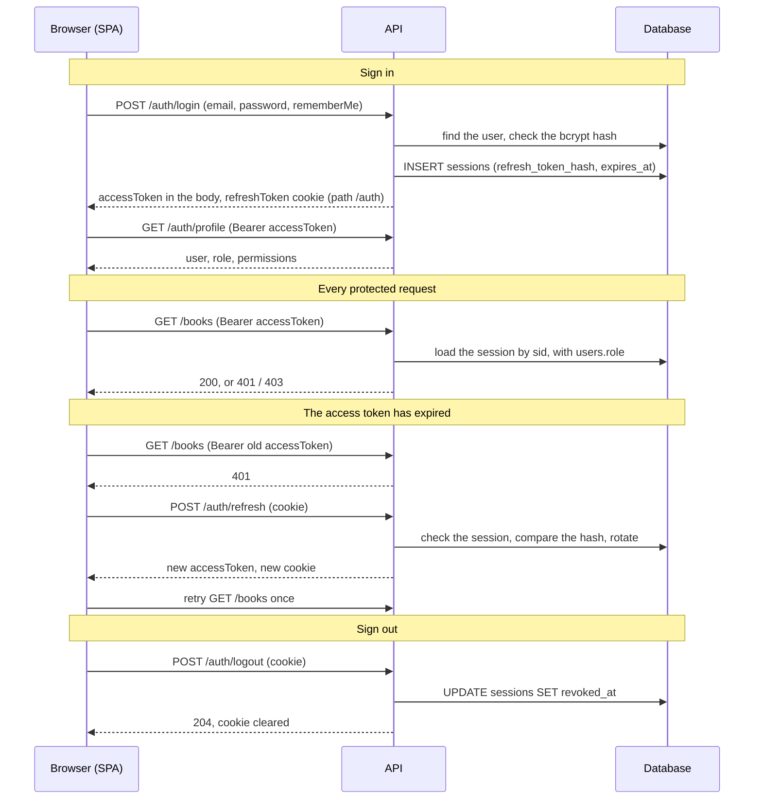
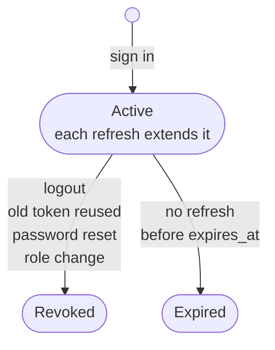
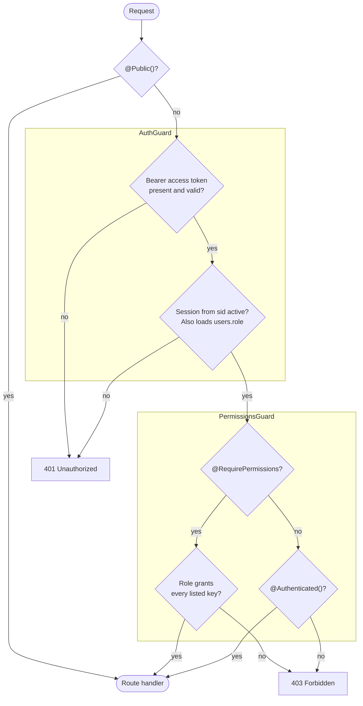
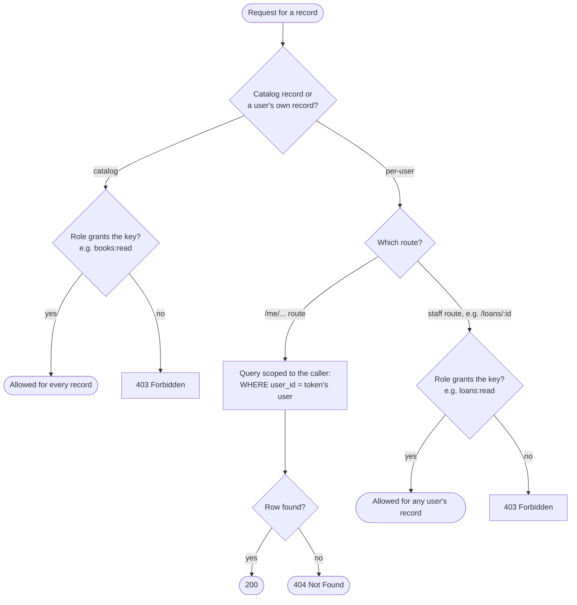
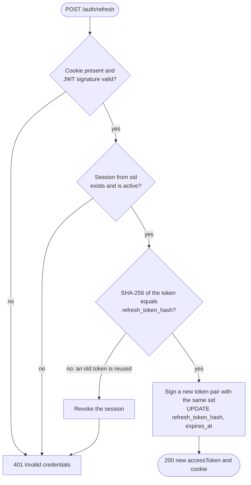
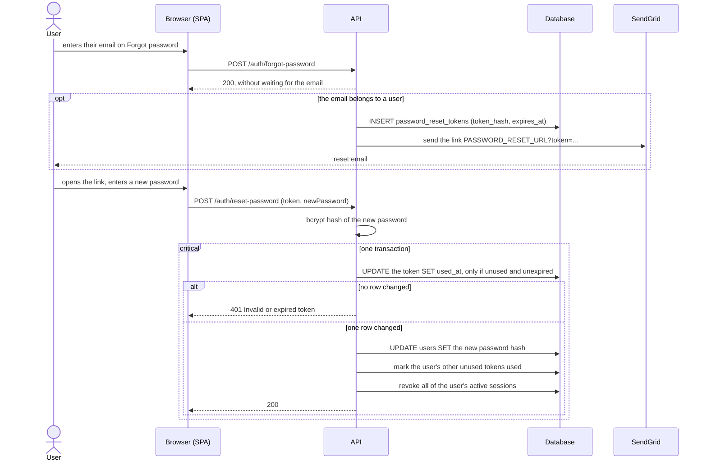

# Authentication and authorization

This spec defines how users sign in, how the API recognizes them on each request, and how it decides what they may do. It covers the flows and the rules each flow must keep.

Related documents:

- [ER diagram](er-diagram.md) defines the `users`, `sessions` and `password_reset_tokens` tables.
- [Roles & Permissions](roles-and-permissions.md) defines the roles, the permission keys and which role gets which key.
- [backend/README.md](../backend/README.md) lists the routes, the environment variables and the local setup.

## Status

The flows and rules describe the code as it is, except where marked:

- **Planned:** depends on a feature that isn't built yet, such as user anonymization or the first per-user resource.
- **Gap:** required behavior that the code doesn't meet yet. Each gap says what happens today. Most are also tracked, with suggested fixes, in [Authentication: deployment readiness](auth-deployment-readiness.md).

All gaps must be closed before the app is deployed.

## Overview

A user signs in once and gets two tokens. The short-lived access token goes with every API call. The refresh token stays in a cookie and is used only to get a new access token. Each step is described in [Flows](#flows).

## Building blocks

### Tokens

| Token         | Format                               | Where the client keeps it                    | Lifetime (default)                                                                            | What the server stores                             |
| ------------- | ------------------------------------ | -------------------------------------------- | --------------------------------------------------------------------------------------------- | -------------------------------------------------- |
| Access token  | JWT, `JWT_ACCESS_SECRET`             | Frontend memory only                         | `JWT_ACCESS_EXPIRES_IN` (15m)                                                                 | Nothing                                            |
| Refresh token | JWT, `JWT_REFRESH_SECRET`            | httpOnly cookie `refreshToken`, path `/auth` | `JWT_REFRESH_EXPIRES_IN` (1d), or with remember me `JWT_REFRESH_REMEMBER_ME_EXPIRES_IN` (30d) | SHA-256 hash in `sessions.refresh_token_hash`      |
| Reset token   | 32 random bytes as 64 hex characters | The link in the reset email                  | `PASSWORD_RESET_TOKEN_EXPIRES_IN` (30m)                                                       | SHA-256 hash in `password_reset_tokens.token_hash` |

Claims:

- **Access token:** `sub` (user id), `sid` (session id), `firstName`, `lastName`. It carries no role and no permissions.
- **Refresh token:** `sub`, `sid`, and a random `jti`, so that two tokens signed in the same second still differ.

### Refresh token cookie

- `httpOnly`, `sameSite=lax`, `path=/auth`, and `secure` when `NODE_ENV=production`.
- With remember me, the cookie gets a `maxAge` equal to the refresh token lifetime, so it survives a browser restart. Without it, the cookie is a session cookie and is gone when the browser closes, even though the session row lives on until `expires_at`.

### Session

A session is one sign-in on one device or browser, stored as a `sessions` row. It is **active** while `revoked_at IS NULL AND expires_at > now()`. Revoking a session sets `revoked_at`. Rows are never deleted while the user exists.

A refresh rotates the token and moves `expires_at` forward. A password reset or a role change revokes every session of the user, not only the current one. Once a session is revoked or expired, its access tokens and its refresh token stop working, and the user has to sign in again.

### Route access levels

Every route has exactly one of these. A route with none of them is denied to everyone.

| Decorator                       | Who may call it                               |
| ------------------------------- | --------------------------------------------- |
| `@Public()`                     | Anyone, signed in or not                      |
| `@Authenticated()`              | Any user with an active session               |
| `@RequirePermissions(key, ...)` | A user whose role grants **every** listed key |

## Request pipeline

Two global guards run on every request, in this order.

1. **`AuthGuard`** skips `@Public()` routes. Otherwise it:
   1. reads `Authorization: Bearer <access token>` and verifies the signature and expiry, or answers **401**;
   2. loads the session named by `sid`, together with `users.role`, or answers **401** if the session is missing, revoked or expired;
   3. sets `request.user` to the token's claims plus the role from the database.
2. **`PermissionsGuard`** skips `@Public()` routes. Otherwise it:
   1. answers **401** if `request.user` is missing;
   2. allows the request if the route has `@RequirePermissions` and the role grants every listed key, and answers **403** if it doesn't;
   3. allows the request if the route has only `@Authenticated()`;
   4. answers **403** for any other route.

The permission check is a lookup in `ROLE_PERMISSIONS` (`backend/src/authorization/role-permissions.ts`), built once at startup. It makes no database query.

## Resource-level authorization

A permission key answers "may this user do this action on this kind of resource?" It doesn't answer "may this user touch this particular record?" For records that belong to a user, both questions need an answer.

LearnLoop has two kinds of resource:

| Kind     | Examples                                                    | Who a record belongs to | What a permission key covers                                                                 |
| -------- | ----------------------------------------------------------- | ----------------------- | -------------------------------------------------------------------------------------------- |
| Catalog  | books, authors, publishers, book copies                     | Nobody; the library     | Every record. `books:read` lets a member read every book, by design.                         |
| Per-user | borrowings (loans), reservations, fines, payments, profiles | The user in `user_id`   | Every user's records. Only staff roles get these keys, so a key never means "only your own". |

Rules for per-user records:

1. **Members use `/me` routes.** A member reaches their own records only through routes such as `GET /me/loans` and `GET /me/loans/:id`, marked `@Authenticated()`. The service takes the owner from `request.user.sub` (`@CurrentUser()`), never from the URL, the query string or the body.
2. **The owner is part of the query.** The ownership condition goes into the SQL itself (`WHERE id = $1 AND user_id = $2`), not into a check after the row is loaded. That way lists, counts and joins can't leak other users' rows either.
3. **Someone else's record is a 404.** A record that exists but belongs to another user answers exactly like one that doesn't exist, so ids can't be probed.
4. **Staff use staff routes.** Routes such as `GET /loans/:id` require the permission key and return any user's records. Members never get these keys.
5. **Writes follow the same rules.** A member cancels a reservation with `POST /me/reservations/:id/cancel`, which runs `UPDATE … WHERE id = $1 AND user_id = $2` and answers 404 when no row changes.
6. **Some fields stay staff-only.** On `/me` routes a member may change only their own contact fields. Role, membership status and membership dates are never accepted there.

**Planned:** no per-user resource has an API yet. Today the only own-record route is `GET /auth/profile`, which loads the user from `sub`. [Roles & Permissions](roles-and-permissions.md) still lists nine member keys marked "Own". This spec follows the fix in that document's risk table: member self-service moves to `/me` routes, and those keys are removed from the member role before the first member-facing endpoint is built.

Ownership trusts `request.user.sub`, so `AuthGuard` must check that `sub` belongs to the session. See [JWT validation](#jwt-validation).

## Flows

### Register: `POST /auth/register`

1. The DTO normalizes the email (trimmed, lowercase) and validates the password.
2. If the email is taken, the API answers **409**. The check runs before the password is hashed.
3. The API hashes the password with bcrypt and inserts the user with the role `member`.
4. The response is the new user. It doesn't sign the user in.

### Sign in: `POST /auth/login`

1. The API looks up the user by normalized email and checks the password with bcrypt. An unknown email and a wrong password both answer **401** `Invalid credentials`.
2. It generates a session id (UUID) and signs both tokens with it.
3. It inserts the `sessions` row with the hash of the refresh token, `remember_me`, and `expires_at` set to the end of the refresh token's lifetime.
4. It sets the refresh token cookie and returns `{ accessToken }`.
5. The frontend stores the access token in memory and calls `GET /auth/profile`, which returns the user, their role and their permission keys.

### Authenticated request

See [Request pipeline](#request-pipeline). Because the session and the role are read on every request:

- revoking a session stops its access tokens at once, before they expire;
- a role change applies to the very next request.

### Refresh: `POST /auth/refresh`

The frontend calls this when an API request gets a 401, and once on page load to restore the session.

1. The API reads the refresh token from the cookie and verifies its signature and expiry, or answers **401**.
2. It loads the session named by `sid`, or answers **401** if it is missing, revoked or expired.
3. It compares the SHA-256 hash of the token with `refresh_token_hash` in constant time. **If they differ, the token is an old one that was already rotated. The API revokes the session and answers 401.** This reuse detection logs out both the real user and anyone holding a stolen copy.
4. It loads the user, signs a new token pair with the same `sid`, overwrites `refresh_token_hash` and moves `expires_at` forward by a full lifetime. `remember_me` keeps its value.
5. It sets the new cookie and returns `{ accessToken }`.

A session therefore stays alive as long as the user comes back within one refresh lifetime, and ends after one lifetime of inactivity.

### Logout: `POST /auth/logout`

1. If the cookie holds a validly signed refresh token, the API revokes its session.
2. The API always clears the cookie and answers **204**, even when the token is missing, invalid or already revoked.
3. The frontend drops the access token from memory.

### Forgot password: `POST /auth/forgot-password`

1. The API answers **200** with no body, whether or not the email is registered.
2. If the email belongs to a user, it inserts a `password_reset_tokens` row and emails a link to `PASSWORD_RESET_URL?token=<token>`. The API doesn't wait for the token insert or the email before answering, so a known email isn't slower to answer than an unknown one, and a mail outage doesn't show up as an error. Failures are logged.
3. Requesting again creates another token. Earlier tokens stay valid until they expire, are used, or a reset succeeds.

### Reset password: `POST /auth/reset-password`

The request carries the token and the new password. The API hashes the new password first, then runs one transaction:

1. **Consume the token** with a single conditional update:
   `UPDATE password_reset_tokens SET used_at = now() WHERE token_hash = $1 AND used_at IS NULL AND expires_at > now()`.
   If no row changes, the token is unknown, used or expired, and the API answers **401** `Invalid or expired token`. Because the check is part of the update, two requests racing with the same link can't both succeed.
2. Store the new password hash.
3. Set `used_at` on every other unused token of the user, so older links stop working.
4. Revoke every active session of the user, so every device has to sign in again with the new password.

The whole journey, from asking for a link to setting the new password:

### Role change

Roles are changed with `npm run user:set-role -- <email> <role>` for now. There is no API route yet.

In one transaction:

1. If the user is being moved away from `admin`, lock all admin rows (`SELECT … FOR UPDATE`). If this user is the only admin, refuse with `Cannot remove the last admin`. The lock stops two concurrent demotions from both passing the check.
2. Update `users.role`.
3. Revoke every active session of the user.

Setting the role a user already has changes nothing and revokes nothing. Revoking the sessions makes the user sign in again, so the frontend reloads their permissions instead of showing stale ones.

### Session restore in the frontend

On page load the app calls `POST /auth/refresh` before rendering any route:

- **Success:** the app loads the profile and the user is signed in.
- **401:** the user is signed out, and guest routes are shown.
- **Network error:** the app shows "Can't reach the server" with a retry button. The user is not signed out.
- **429:** the app shows "Too many requests" and keeps the retry button disabled until `Retry-After` has passed.

During use, `setupAuthInterceptor` retries a request once after a 401. All requests that fail at the same moment share one refresh call. The access token is cleared only when the refresh itself answers 401, not on a network error or a 429.

## Failure handling

| Scenario                                          | Expected behavior                                                                                                                                                                                                                                                                                                                                                           | Today                                                                                                                                                                                                                                                          |
| ------------------------------------------------- | --------------------------------------------------------------------------------------------------------------------------------------------------------------------------------------------------------------------------------------------------------------------------------------------------------------------------------------------------------------------------- | -------------------------------------------------------------------------------------------------------------------------------------------------------------------------------------------------------------------------------------------------------------- |
| PostgreSQL is unavailable                         | Every route, including the guard's session lookup and refresh, answers **503** with `Retry-After`. Never 401: the session may still be valid, so the frontend keeps the user signed in and shows "Can't reach the server".                                                                                                                                                  | **Gap.** `AuthGuard` lets the database error through instead of answering 401, and a test covers that. But nothing maps the error to 503, so the answer is a 500. The frontend already treats any 5xx as "unavailable" and doesn't sign the user out.          |
| A refresh response is lost after rotation         | The browser still holds the old cookie and retries. If the old token matches the session's previous hash and the rotation happened less than about 30 seconds ago, the server treats this as a retry, not theft: it rotates again and doesn't revoke. After that window, reuse detection applies as usual.                                                                  | **Gap.** The old token counts as reuse, so the session is revoked and the user is signed out. The fix needs two new columns, `sessions.previous_refresh_token_hash` and `sessions.rotated_at`; add them to the [ER diagram](er-diagram.md) when they're built. |
| Two browser tabs refresh at the same moment       | Neither tab is signed out and the session stays active. The frontend runs one refresh at a time across tabs (Web Locks API), so the second tab sends the cookie the first one just received. The server rotates with a compare-and-swap (`UPDATE … WHERE id = $1 AND refresh_token_hash = $2`), and the grace window from the previous row covers any race the lock misses. | **Gap.** The interceptor shares one refresh within a tab only. Two overlapping refreshes were shown to revoke the session in 5 out of 5 runs.                                                                                                                  |
| The email provider is unavailable                 | Documented delivery failure: `forgot-password` still answers 200, the error is logged without the token or the link, the token expires unused, and the user can ask again (up to 3 times per hour). If delivery must be guaranteed, a durable retry (an outbox table and a worker) is needed.                                                                               | **Done** for the documented failure. Durable retry is **Planned** and must be decided before deployment.                                                                                                                                                       |
| The access token expires during several API calls | One refresh call. Every request that got a 401 waits for it and is retried once. If the refresh answers 401, they all fail and the user is signed out once. After a network error or a 429 the user stays signed in.                                                                                                                                                        | **Done** within one tab (`setupAuthInterceptor`). Across tabs, see the row about two tabs above.                                                                                                                                                               |
| The user is deleted or anonymized                 | Every path rejects the account: sign in, refresh, existing access tokens and reset links.                                                                                                                                                                                                                                                                                   | **Done** for deletion: the foreign keys delete the user's sessions and reset tokens, so every path answers 401. **Planned** for anonymization (rule 13).                                                                                                       |

## Security boundaries

### CORS

- The allowed origins come only from `CORS_ORIGINS`: a comma-separated list of exact origins (scheme, host and port, with no path and no wildcard). Startup validation rejects any other format.
- CORS runs with `credentials: true`, so browsers send the refresh cookie on calls from these origins. That is why the list must never be `*` and must never echo back whatever `Origin` the request sends.
- Only `Retry-After` and `Retry-After-login-ip` are exposed to the frontend.
- In production the list holds the production frontend origin only, over `https`, with no `localhost`.
- CORS only controls what a browser lets a page read. It is not access control: `curl` and scripts ignore it, so every route still depends on the guards.

### CSRF

The API accepts two kinds of credential, and only one of them can be forged by another site:

- **Bearer access token:** the browser never attaches it on its own, so routes that use it can't be called from another site with the user's credentials. They need no CSRF defense.
- **Refresh cookie:** the browser attaches it automatically to every `/auth/*` request. Only `POST /auth/refresh` and `POST /auth/logout` read it.

How the cookie routes are protected:

1. The cookie is `SameSite=Lax`, so the browser doesn't send it on a POST from another site. It must never be `SameSite=None`, which would need a CSRF token.
2. Routes that read the cookie are POST only. `Lax` still sends cookies on top-level GET navigation, so a GET route that read the cookie could be triggered by any link.
3. Even a forged refresh gives an attacker nothing to read: CORS stops their page from reading the new access token.
4. **Gap:** `SameSite` counts every subdomain of a site as the same site, so a page on another subdomain (for example a compromised `blog.example.com`) could still log the user out. Before deployment, `refresh` and `logout` must also check that the `Origin` header is in `CORS_ORIGINS`, and answer 403 otherwise.

Because the cookie is `Lax`, the frontend and the API must be hosted on the same site (for example `app.example.com` and `api.example.com`). Otherwise the browser never sends the cookie and every page reload signs the user out.

### JWT validation

| Check                       | Required                                                                                                                                         | Today                                                                                                                                                                                                                                |
| --------------------------- | ------------------------------------------------------------------------------------------------------------------------------------------------ | ------------------------------------------------------------------------------------------------------------------------------------------------------------------------------------------------------------------------------------ |
| Algorithm                   | Sign with `HS256`, and verify with an explicit allowlist, `algorithms: ['HS256']`. Reject `none` and every other algorithm.                      | **Gap**, low risk. `HS256` is the library default for signing, and the library already rejects `none` and public-key algorithms for a string secret. But the allowlist isn't written in the code, so it depends on library defaults. |
| Signature and expiry        | Both verified on every use.                                                                                                                      | **Done.**                                                                                                                                                                                                                            |
| Issuer (`iss`)              | Set to `learnloop-api`, and checked.                                                                                                             | **Gap.** Not set.                                                                                                                                                                                                                    |
| Audience (`aud`)            | Set to `learnloop-api`, and checked, so a token made for another service with the same secret is refused.                                        | **Gap.** Not set.                                                                                                                                                                                                                    |
| Token purpose               | Each token carries `typ: 'access'` or `typ: 'refresh'`, and each check accepts only its own type. Different secrets separate them a second time. | **Gap.** Only the two secrets separate the tokens, and config doesn't stop them being identical. With identical secrets, a refresh token (valid up to 30 days) would be accepted as an access token.                                 |
| Session id (`sid`)          | Required. A token without one is refused.                                                                                                        | **Done.**                                                                                                                                                                                                                            |
| Subject matches the session | `sub` must equal the session's `user_id`.                                                                                                        | **Gap.** `AuthGuard` checks that the session is active, but not that it belongs to `sub`. This only matters if the access secret leaks, but resource-level checks trust `sub`.                                                       |

### Secret rotation

Requirements for the secrets themselves:

- Each secret is at least 32 random bytes (64 hex characters).
- The two secrets are different.
- They come from the host's secret store and are never committed.
- **Gap:** today config accepts any string, including `change-me` and two identical values.

What changing a secret does today:

- **`JWT_ACCESS_SECRET`:** every access token stops working, and the frontend refreshes without the user noticing. It's safe to change at any time.
- **`JWT_REFRESH_SECRET`:** every refresh token stops working, so every user is signed out at their next refresh.

Strategy:

- **Routine rotation** (yearly, or when someone with access to the secrets leaves): change the access secret at any time. For the refresh secret, the API must accept two secrets at once, chosen by a key id (`kid`) in the token header. It signs with the new secret and verifies with either, and drops the old one after the longest refresh lifetime (30 days). **Gap:** there is no key id support yet. Until there is, changing the refresh secret signs everyone out, which is acceptable while nothing is deployed.
- **Emergency rotation** (a secret leaked): change both secrets at once with no overlap, and revoke every session with `UPDATE sessions SET revoked_at = now() WHERE revoked_at IS NULL`. The access secret is the urgent one. With it, an attacker can mint access tokens for any active session id they know. A leaked refresh secret alone can't mint a refresh token the server accepts, because the token's hash must match the one stored in the session.

### HTTPS

- In production the frontend and the API are served only over HTTPS. The proxy redirects HTTP to HTTPS.
- The refresh cookie has the `Secure` flag everywhere except local development. **Gap:** the flag depends on `NODE_ENV=production`, and config doesn't validate `NODE_ENV`. If the host doesn't set it, the cookie can travel over plain HTTP.
- The API sends `Strict-Transport-Security`. **Gap:** the API sends no security headers yet.
- Behind a proxy, the app trusts the proxy's forwarded client address, so rate limits count real client IPs. **Gap:** `trust proxy` isn't set, so every user would share one rate-limit bucket.
- `CORS_ORIGINS` and `PASSWORD_RESET_URL` use `https` in production. A reset link over HTTP would expose the token.
- Plain HTTP is allowed only on `localhost` during development.

## Rules

These rules are the contract. A change that breaks one of them needs this spec updated first.

### Credentials and secrets

1. Passwords are stored only as bcrypt hashes (10 rounds). A password has at least 6 characters and at least one uppercase letter.
2. Refresh tokens and reset tokens are stored only as SHA-256 hex digests. The raw tokens exist only in the cookie and in the email link. SHA-256 is used for refresh tokens because bcrypt reads only the first 72 bytes, and a JWT's first 72 bytes are mostly its fixed header.
3. Token hashes are compared in constant time.
4. The access token and the refresh token are signed with two different secrets, so neither can be used as the other.
5. The access token lives only in frontend memory, never in `localStorage` or a readable cookie. The refresh token lives only in the httpOnly cookie, which is sent only to `/auth` routes.
6. Emails are normalized (trimmed, lowercase) before every lookup and insert, and the database rejects emails that aren't normalized.

### Sessions

7. Each sign-in creates exactly one session. A user may have any number of active sessions.
8. An access token is accepted only while its session is active. A valid signature and an unexpired token aren't enough.
9. Each refresh replaces the refresh token. Presenting a replaced refresh token revokes the session.
10. Logout revokes only the current session.
11. A successful password reset revokes all of the user's sessions.
12. A role change revokes all of the user's sessions.
13. **Planned:** anonymizing a user revokes all of their sessions and marks their unused reset tokens used. An anonymized user can't sign in, refresh or reset their password.

### Password reset

14. A reset token is single-use and expires after `PASSWORD_RESET_TOKEN_EXPIRES_IN`.
15. A successful reset invalidates every other unused reset token of the user.
16. Consuming the token, storing the new password, revoking the other tokens and revoking the sessions happen in one transaction. Either all of them happen, or none do.
17. `forgot-password` answers the same way, at the same speed, whether or not the email is registered.

### Authorization

18. Every route is denied unless it is marked `@Public()`, `@Authenticated()` or `@RequirePermissions(...)`.
19. Routes check permission keys, never role names.
20. The role is read from the database on every request. Tokens never carry the role or the permissions. See [Role lookup on every request](#role-lookup-on-every-request) for why.
21. What each role may do is defined in code (`ROLE_PERMISSIONS`), not in the database. See [Roles & Permissions](roles-and-permissions.md).
22. Registration always creates a `member`. No request body can set or change a role.
23. The last admin can't lose the admin role.
24. The frontend hides what the user can't do (`RequirePermission`, `useCan`), but only the API enforces it. The frontend `Permission` type mirrors `backend/src/authorization/permissions.ts` by hand.

### Errors

25. Authentication failures answer **401** with a generic message (`Invalid credentials`, `Invalid or expired token`) that doesn't say which check failed.
26. A signed-in user without the needed permission gets **403**.
27. A database failure never answers 401. Only a real authentication failure signs the user out.

### Resource access

28. A permission key covers every record of its resource. Members never get keys for per-user resources.
29. **Planned:** a member reaches per-user records only through `/me` routes. The owner comes from the token's user and is part of the query. Another user's record answers 404.

### Boundaries

30. Every route that reads the refresh cookie is a POST.
31. The refresh cookie is never `SameSite=None`.
32. CORS allows an exact list of origins, never `*` and never an echoed `Origin`.
33. Every token is checked for its signature, its expiry, its session id and, once the gaps are closed, its algorithm, issuer, audience and purpose.

## Rate limits

Limits are per client IP unless stated. A blocked request gets **429** with a `Retry-After` header.

| Route                        | Limit                                                                     |
| ---------------------------- | ------------------------------------------------------------------------- |
| `POST /auth/login`           | 5 per minute per IP and email, and 20 per minute per IP across all emails |
| `POST /auth/register`        | 3 per minute                                                              |
| `POST /auth/forgot-password` | 3 per hour                                                                |
| `POST /auth/reset-password`  | 5 per 15 minutes                                                          |
| Every other route            | `THROTTLE_LIMIT` per `THROTTLE_TTL` (60 per minute by default)            |

Login is counted per IP and email so that one user mistyping their password can't lock out other users behind the same IP.

## Testing and verification

Backend unit tests run with `npm test`, and e2e tests run against a real Postgres with `npm run test:e2e`. CI runs both on every push. The frontend has no test runner yet.

A gap is closed only together with a test that would fail without the fix.

| Area                         | What must be tested                                                                                                                                                          | Where                                                                                                                                               | Status                                                                                                                                      |
| ---------------------------- | ---------------------------------------------------------------------------------------------------------------------------------------------------------------------------- | --------------------------------------------------------------------------------------------------------------------------------------------------- | ------------------------------------------------------------------------------------------------------------------------------------------- |
| Authentication guard         | Missing or malformed header, a bad signature, a missing, revoked or expired session, a token without `sid`, `@Public()` routes skipped, a database error not reported as 401 | `auth.guard.spec.ts`; e2e `/auth/profile`                                                                                                           | **Covered.** Add "`sub` doesn't match the session" with that fix.                                                                           |
| Permission guard             | No decorator, an empty key list, `@Authenticated()`, `@Public()`, a missing key, only some keys granted, no user on the request                                              | `permissions.guard.spec.ts`; `role-permissions.spec.ts` (every role and key); e2e `books authorization` (every role and route, 401 without a token) | **Covered.**                                                                                                                                |
| Expired and revoked sessions | Access tokens refused after logout, password reset and role change, and once the session expires                                                                             | `auth.guard.spec.ts`; e2e `access tokens of a revoked session`, role change test                                                                    | **Covered.** Expiry is tested in unit tests only.                                                                                           |
| Refresh rotation and reuse   | Rotation keeps `remember_me` and `sid`, a replayed token revokes the session, a revoked session is refused                                                                   | `auth.service.spec.ts` (`refresh`)                                                                                                                  | **Partial.** Missing an e2e round trip with real cookies: sign in, refresh, replay the old cookie, and expect 401 with the session revoked. |
| Concurrent refreshes         | Two refreshes with the same cookie at once don't revoke the session. A replayed previous token inside the grace window is accepted                                           | None                                                                                                                                                | **Missing.** Fails today; see [Failure handling](#failure-handling).                                                                        |
| Concurrent password resets   | Two resets with the same token at once: exactly one succeeds                                                                                                                 | `password-reset.service.spec.ts` (in-memory fake); e2e rollback test                                                                                | **Partial.** Missing an e2e test against Postgres: two simultaneous resets with one link, exactly one 200.                                  |
| Concurrent role changes      | Two admins demoted at once leave one admin                                                                                                                                   | e2e `stays an admin when two admins are demoted at the same time`                                                                                   | **Covered.**                                                                                                                                |
| Last-admin protection        | The only admin can't be demoted; demotion works while another admin remains; the check reads the locked rows; promotion doesn't lock                                         | `auth.service.spec.ts` (`last admin`); e2e `last admin`                                                                                             | **Covered.**                                                                                                                                |
| Frontend refresh concurrency | Several 401s cause one refresh; each request is retried once; a 401 from refresh signs out; a network error or 429 doesn't; tabs refresh one at a time                       | None                                                                                                                                                | **Missing.** Needs Vitest and MSW in `frontend/`.                                                                                           |
| Cross-user resource access   | User A gets 404 for user B's record by id and sees none of B's rows in lists; a member gets 403 on staff routes                                                              | None                                                                                                                                                | **Planned.** Every `/me` route ships with this test.                                                                                        |
| Database unavailable         | The guard and refresh answer 503, not 401                                                                                                                                    | `auth.guard.spec.ts` checks that the error isn't turned into 401                                                                                    | **Partial.** Add an assertion on 503 with that fix.                                                                                         |
| Deleted user                 | Access token, refresh and reset link all refused after the user is deleted                                                                                                   | None                                                                                                                                                | **Missing.**                                                                                                                                |
| Rate limits                  | Global limit, login per email and per IP, forgot-password                                                                                                                    | `throttling.e2e-spec.ts`                                                                                                                            | **Covered.**                                                                                                                                |

## Design decisions

### Role lookup on every request

**Decision:** the access token carries only the user id and the session id. `AuthGuard` reads the user's role from the database on every request, and `PermissionsGuard` turns the role into permissions with `ROLE_PERMISSIONS` in code. Neither the role nor the permissions go into the JWT.

**Why:**

1. **A role change applies at once.** A role inside the JWT would stay valid until the token expires, up to `JWT_ACCESS_EXPIRES_IN` (15 minutes). An admin demoted because their account was stolen would keep admin rights for that whole time.
2. **It costs almost nothing extra.** `AuthGuard` already loads the session on every request to check that it isn't revoked (rule 8). The role comes back in the same query, joined from `users`. A truly stateless JWT would save that query only if we also gave up instant logout and session revocation.
3. **Permissions stay in code, not in tokens.** If the token listed permissions, every token would keep the grants that existed when it was signed. A deploy that changes `ROLE_PERMISSIONS` would take up to one token lifetime to apply. The frontend reads the permission list from `GET /auth/profile` instead.
4. **It's a safety net.** Role changes also revoke the user's sessions (rule 12), so today a role in the token would happen to work. Reading the role from the database means a future code path that changes a role but forgets to revoke sessions is still enforced correctly.

**Cost:** every authenticated request needs the database: one primary-key lookup with a join. The API can't authenticate any request while Postgres is down, and a second service couldn't check access tokens on its own without the same database.

**When to revisit:** if this query ever shows up as a bottleneck, cache the session and role for a few seconds. Don't move the role into the JWT. That would bring back the problems in points 1 and 3.
